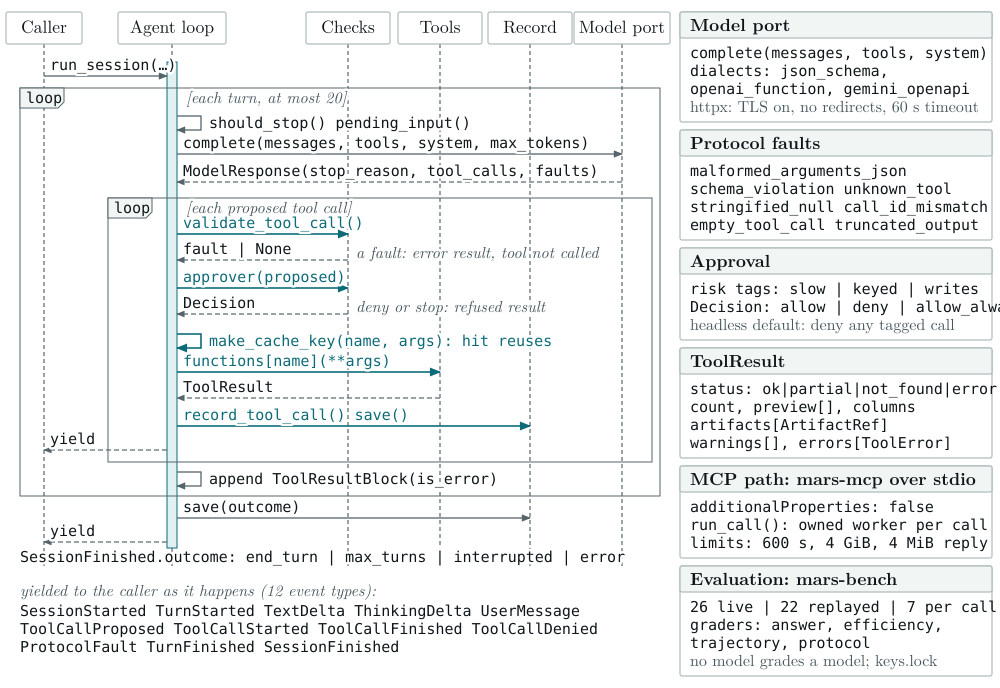

# MARS's Layers: Tools, Turn-Taking, and the Harness

Date: 2026-11-01
Status: current-state reference, except §6 and one box in the first figure,
which are proposed work and are labelled as such

Three separable things in MARS (MCP Astronomy Research Suite) get called by the same words. This
document draws the difference, because the distinction decides where a change
belongs: a new astronomy capability, a change to how a turn is taken, and a
change to how a run is governed are three different PRs touching three
different layers.

[tool-architecture.md](tool-architecture.md) is the master architecture; this
is the layer map over it. Line counts are `wc -l` over tracked Python sources
on `main` at 2026-11-01, tests excluded.

| Layer | Path | Lines | Model-aware? |
| --- | --- | ---: | --- |
| Harnesses | `tools/tui/` + `tools/bench/` | 10,725 | yes |
| Turn-taking | `tools/agent/` | 1,226 | yes |
| Model port | `tools/llm/` | 2,580 | yes |
| MCP server and skill | `tools/mcp/` + `tools/skill/` | 2,645 | serves schemas to a host's model; calls none |
| Tool surface | `tools/*.py` + `tools/runtime/` | 15,180 | schema-shaped; calls none |
| Algorithms | `algorithms/` | 23,100 | no |
| **Non-test total** | | **55,456** | 26.2% of it |

Plus 41,355 lines of tests. Most are algorithm-preservation tests: they pin
parity with recorded upstream output, known bugs included, which establishes
parity rather than scientific correctness; deliberate corrections have their
own tests against independent references (`tests/README.md`).

The five figures below are generated, and every count printed in them is
read from the checkout when they are drawn (see the end of this document).
The first figure, §1, §2 and §5 describe MARS as it is, apart from one box
in the first figure labelled as proposed; §6 is proposed work.

---

## MARS at a glance

<picture>
  <source media="(prefers-color-scheme: dark)" srcset="assets/architecture/fig-4-agent-loop-dark.svg">
  
</picture>

The rest of this document is the machinery; this is the path one question
takes through it. The question enters from the console, a Python caller or
the benchmark harness and becomes the conversation. The model port sends the
conversation and the tool schemas to whichever provider is configured, and
gets back the calls the model proposes. Each call then passes schema
validation, the approval policy (which asks the researcher before a slow,
keyed or writing call, and by default refuses one when there is nobody to
ask) and the repeat-call cache, before tool dispatch runs it on one of the 55
tools. A call that fails validation or is refused goes back to the
conversation as an error, unrun. Every result is written to the session
record and returned to the model for the next turn, by default at most 20
(§2). The computation happens in the tools, not in the model. The answer and
its artifacts go back to whoever asked; the benchmark grades recorded
sessions (§5).

The providers, the tool groups and the turn limit are read from the code when
the figure is drawn. The Skynet 2 box is the observing interface proposed in
§6.

---

## 1. MARS as built

<picture>
  <source media="(prefers-color-scheme: dark)" srcset="assets/architecture/fig-1-mars-as-built-dark.svg">
  
</picture>

Read it top to bottom. Four kinds of caller enter at the top; only two of them
go through MARS's own loop. A Python script or notebook calls the tools
directly with no model in the path, and an MCP client brings its own model and
its own loop, so `mars-mcp` checks each call against the tool's schema with
`additionalProperties: false` and lets nothing undeclared through.

The dashed line is the trust boundary. Above it, a model proposes; below it,
tested software computes. A model's request crosses only as a call that has
passed its tool's schema, on either path. Everything below the line is an
ordinary Python function a script can import, and does not know a model
exists. Serving is optional too: the console opens no port.

The one-way rule is enforced rather than aspirational: nothing under
`algorithms/` imports `tools/agent/` or `tools/llm/`, and the adapters never
import `tools/registry.py`, because translating 55 schemas into a provider's
dialect is the engine's job and it does it once before the turn loop starts
(`docs/tool-architecture.md` §10).

The algorithm lane is grouped by where the code came from, because that is
what decides how it may change: extracted from the Skynet pipeline and
Afterglow, ported from Astromancer, or first-party. §5 is the evidence for the
first two.

> **One known exception to the wider folder split.**
> `algorithms/hrdiagram_py/local_grid.py` and `isochrones.py` both do
> `from tools import config`, to read `ISOCHRONE_DIR`. It is a data-root
> setting, not a model dependency, so the model boundary above is intact —
> but `algorithms/` → `tools/` is not quite as clean as the folder split
> implies.

---

## 2. The turn-taking layer and its gates

`run_session()` in `tools/agent/engine.py`, 558 lines, about 1% of the
repository. It takes a user message and a backend, yields an iterator of
events, and takes a `Decision` back in through an approver callable. Keeping
the two directions separate is what lets a console, a benchmark and a plain
`for` loop consume it unchanged.

<picture>
  <source media="(prefers-color-scheme: dark)" srcset="assets/architecture/fig-5-agent-engine-dark.svg">
  
</picture>

The same loop, one turn at a time and named as the code names it. Every
identifier in the figure, and every enumeration in its cards, is read from
the code when it is drawn: the fault types from `tools.llm.types.FaultType`,
the risk tags from `tools.agent.policy.RiskTag`, the twelve events from
`tools.agent.events.Event`, the MCP worker's limits from
`tools.runtime.limits.CallLimits`. The MCP path runs each call in its own
worker process; the agent loop calls the tool function in-process.

Turn-taking alone is four steps: call the model, dispatch the calls it asks
for, append the results, repeat. Strip everything else out of the frame in §1
and that loop still works — and it cannot be interrupted, cannot be corrected
mid-run, dispatches malformed arguments straight into real functions, asks
nobody before a 121,515-product archive download, re-issues the same failing
call every turn, and leaves no record when it dies. The eight gates drawn in
the frame are the difference between a loop and a harness:

> A harness is what makes a model's run **governable, observable, reproducible
> and gradeable**. Turn-taking is the least of it.

| Gate | Where it sits | The failure it prevents |
| --- | --- | --- |
| `should_stop` | every turn, and before each call | A run you cannot get out of. A pending call is refused with an `interrupted` result rather than abandoned: every `tool_use` needs a `tool_result` or the conversation can never be sent again. |
| `pending_input` | top of every turn | A correction arriving only after the run is over. Merged into the trailing user message, not sent as its own turn — two consecutive user messages are not a shape every provider accepts. |
| `ProtocolFault` | after `complete()` | A tool call truncated at the token ceiling being read as an intentional one. |
| `validate_tool_call` | before dispatch | A malformed argument reaching a real function and raising mid-turn. An undeclared property is refused as well as a mistyped one. The tool is never called; an error result goes back to the model and the loop continues (S8). |
| `approver` | before dispatch | 121,515 MAST products downloaded because a model set `download=true`. Calls are tagged `slow`, `keyed` or `writes`; a download's risk is read from the *argument* (`DOWNLOAD_FLAGS`), so an ordinary archive search stays unprompted. |
| `make_cache_key` | before dispatch | A model re-issuing an identical failing call across turns — observed in a real transcript, burning half a six-turn budget on one bad NED query. |
| `session.save()` | after every call | A killed run leaving nothing readable behind. The manifest is written at session start, after every tool call, and at every terminal state. |
| `max_turns = 20` | the loop itself | An unbounded spend. |

---

## 3. The tools

55 ordinary Python functions, registered in `tools/registry.py` as an
Anthropic-dialect schema plus the callable it maps to. They stay thin: accept
normal values, normalise and validate locally, call an algorithm package
rather than reimplementing astronomy, and return a small Pydantic model plus
warnings, errors and artifact paths.

> **One public tool call is MARS's execution boundary.** No run, stage,
> session or batch object spans two calls; no tool writes state another tool
> reads.

A call down through the tool layer converts a model's JSON into Python values;
the result coming back converts a typed result into bounded JSON and a path on
disk. The tool layer exists to own those two conversions, so the algorithm
never has to know it is being called by a model and the model is never handed
a NumPy array. That is the working rule stated in `tool-architecture.md`:
*Astropy-native inside, JSON-and-artifact-native outside.*

It is also why the pulsar pipeline's stage order lives in a system prompt
rather than a state machine, and why folding at a wrong period returns a flat
profile instead of an error (`docs/pulsar-tool-pipeline.md`).

### The tools are not one surface — they are three

The five groups in §1 are how `mars-mcp --tools` partitions the surface. The
split that matters for reproducibility runs across them: 26 tools are local,
22 remote and 7 mixed. The classification is per tool, never per module:
`tools.hr_diagram` alone spans all three classes, and
`get_literature_cluster_params` returns published cluster parameters yet
fetches them through VizieR. This table
(`tools/bench/plane.py::TOOL_CLASSES`) is the mechanism that lets a benchmark
replay the remote half of the surface while still running the computational
half for real (§5).

---

## 4. Two harnesses, one loop

`run_session()` takes its backend, its approver and its tool functions as
arguments, plus three optional hooks (`on_delta`, `pending_input`,
`should_stop`). The console and the benchmark are both callers that fill them
in differently; the loop is the same code in both and cannot tell which one
invoked it.

The console puts a person in those arguments; the benchmark puts a recorder in
them, with remote services replayed. That is the entire difference. Neither is
the loop; both are harnesses *around* it, and the loop was designed with
exactly enough seams that neither had to modify it. See `tool-architecture.md`
§10.2 for the console and `benchmarking/harness.md` for the benchmark.

---

## 5. Validation

<picture>
  <source media="(prefers-color-scheme: dark)" srcset="assets/architecture/fig-3-validation-dark.svg">
  
</picture>

Two questions, answered separately because a correct algorithm does not make
a model use it correctly.

**Is it the same algorithm?** The left panel. Nothing was rewritten:
[extraction.md](extraction.md) records the upstream file and line ranges per
domain, every severed dependency carries an inline `EXTRACTED:` marker, the
ports carry `PORTED:` ones, and the preservation tests hold the
result against recorded upstream output — known bugs included, because
passing them establishes parity, not correctness. Deliberate corrections are
tested separately against independent references. CI runs the suite on both
supported Pythons against `uv.lock`, scans the tree and its history for
secrets, and audits the workflows; a release reaches PyPI only after TestPyPI
serves the same wheel byte for byte and it installs
([releasing.md](releasing.md)).

**Does a model use it correctly?** The right panel. Every task has an answer
key, mostly of what an answer must *not* claim; a run goes through the
console's loop unchanged, with every call that would reach a remote service
replayed from recorded fixtures; and grading is a separate step with no model in it, so a
corrected check re-grades recorded sessions without re-running them.
The results box is the September 2026 sweep. It was graded before the
attribution checks were added, and its original transcripts are not in the
repository, so those rates are historical: see
[benchmarking/results.md](benchmarking/results.md) for what they do and do not
establish. Their 95% intervals overlap for the top two backends, which the
suite therefore does not separate.

The dashed box is not built. It is §6's proposed work carried into
evaluation.

---

## 6. Proposed: from scientific intent to evidence

> **Proposed, not built.** "Aim 2" is the work this section describes and
> "Aim 3" its validation (§5). Nothing drawn dashed exists in this
> repository.

<picture>
  <source media="(prefers-color-scheme: dark)" srcset="assets/architecture/fig-2-aim-2-proposed-dark.svg">
  
</picture>

The proposed work extends MARS from analysing data to helping plan the
observations that produce it, through Skynet 2. Its division of
responsibility is the point of the figure:

- **MARS** translates a scientific objective into measurement requirements
  against the instrument capabilities Skynet 2 has registered, proposes an
  observing-and-analysis plan, and — after the user approves it — submits an
  instrument-agnostic request through a constrained interface. When data
  return it analyses them with the tools that exist today, and judges
  scientific adequacy separately from operational success.
- **The user** approves the plan and every consequential action, and receives
  either the result with its evidence or the requirement that limited it,
  with a follow-up to review.
- **Skynet 2** keeps facility selection, scheduling and execution. Its boxes
  are its own pathway (access control and capability matching, scheduler,
  SkyNode gateway, data storage, pipeline and QA), collapsed into one lane;
  it is funded separately, by NSF ATI.

The approval box is the same rule as §2's approver, applied where a call has
physical consequences.

---

## 7. The difference, stated plainly

| | Answers | Fails when | Here |
| --- | --- | --- | --- |
| **Tools** | "What can be done?" | The astronomy is wrong. | `tools/*.py`, `tools/runtime/` and `algorithms/` — 38,280 lines |
| **Turn-taking** | "Whose move is it?" | A `tool_use` goes unanswered and the conversation cannot be resent. | `run_session`'s model call, dispatch and append |
| **Harness** | "Can this run be trusted, stopped, explained, repeated and scored?" | A run costs money nobody approved, or produces a number nobody can reproduce. | The eight gates, plus `tools/tui/` and `tools/bench/` — 10,725 lines |

The tools decide what is *possible*, turn-taking decides what happens *next*,
and the harness decides what is *permitted, recorded and believed*.

**So: is MARS a harness?** No — it contains two. MARS is an astronomy
capability library that ships a console and a benchmark over it. The
turn-taking genuinely is a thin wrapper, deliberately so, and it is also not
where the engineering is: nothing in `tools/*.py` or `algorithms/` imports the
loop or the model port at run time, so a script that never configures a model
still solves plates and folds pulsars. The evidence that a harness is not the
loop is §4 — two harnesses share the loop verbatim and differ only in the
arguments they pass. If turn-taking were the harness, that substitution would
be impossible.

This is the reading the code supports where the prose disagrees with itself:
`README.md` calls MARS "an agentic, tool-enabled system", while
`tool-architecture.md` §9 lists "No orchestration framework" as a non-goal.
Both are true of different layers.

---

## 8. Where to check each claim

| Claim | File |
| --- | --- |
| The loop, all of it | `tools/agent/engine.py` — `run_session`, and `_run_tool_turn` for each call |
| The twelve events consumers read | `tools/agent/events.py` |
| Approval, and risk carried by an argument | `tools/agent/policy.py` — `TOOL_RISK`, `DOWNLOAD_FLAGS`, `risk_tags` |
| Pre-dispatch validation | `tools/llm/validation.py` — `validate_tool_call` |
| The four model providers | `tools/llm/factory.py` — `RECOGNIZED_PROVIDERS` |
| The MCP server's strict check | `tools/mcp/server.py` — `_StrictValidator` |
| The 55 schemas and the 55 callables | `tools/registry.py` — `TOOL_SCHEMAS`, `TOOL_FUNCTIONS` |
| The five groups | `tools/mcp/groups.py` — `GROUPS` |
| The three tool classes and their predicates | `tools/bench/plane.py` — `TOOL_CLASSES`, `OFFLINE_PREDICATES` |
| The download caps | `tools/downloads.py` — `MAX_PRODUCTS`, `MAX_DOWNLOAD_BYTES`, `MAX_TRANSFER_SECONDS` |
| The pinned data bundles | `tools/mcp/bundles.json` |
| Where each algorithm came from | [extraction.md](extraction.md) |
| CI and the release gates | `.github/workflows/ci.yml`, `release.yml`, `secret-scan.yml`, `workflow-safety.yml` |
| The September 2026 sweep | `docs/benchmarking/report.json`, read by the figure; [results.md](benchmarking/results.md) |
| The console filling the seams | `tools/tui/app.py` — its `run_session(...)` call |
| The benchmark filling the seams | `tools/bench/harness.py` — its `run_session(...)` call |

## Regenerating the figures

The ten SVGs under `assets/architecture/` are generated by
`assets/architecture/make.py` — one geometry per figure, a `-light`/`-dark`
pair behind a `<picture>` element, the same pattern the README banner uses.
It imports the registry to count the tools, so run it in the project
environment:

```bash
uv run python docs/assets/architecture/make.py
```

Every number a figure prints is measured from the checkout at that moment —
tool counts and classes, marker counts, test functions, frames and scans,
download caps, CI Pythons, the sweep in `report.json`, the engine's
enumerations, the model providers and the tool groups — so re-run it after a
change that moves one; a new provider or tool group fails the run until the
first figure names it. Labels are fitted against CMU Serif's metrics and the
run fails if one overflows its box or uses a glyph the font lacks; each SVG
embeds a subset of the face, so a browser renders it in the font it was fitted
to. The fit check needs the CMU fonts installed (`/usr/share/fonts/cm-unicode`
on the development host) and is skipped with a warning without them.

`--print DIR` also writes a print set — SVG, PDF and a 600-dpi PNG, 6.5
inches wide, greyscale except the engine — for documents outside the
repository. It needs
`rsvg-convert` (librsvg), and its output is not committed.
